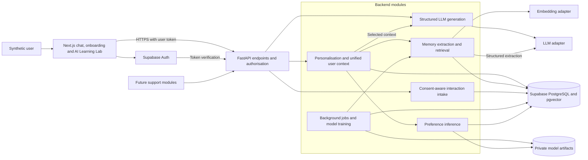
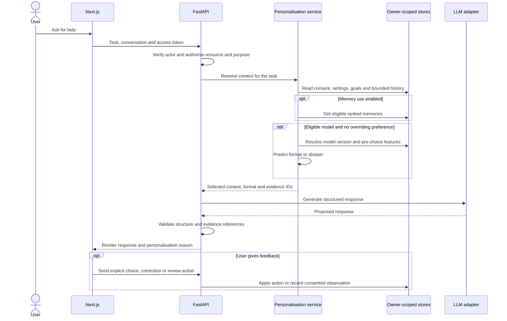
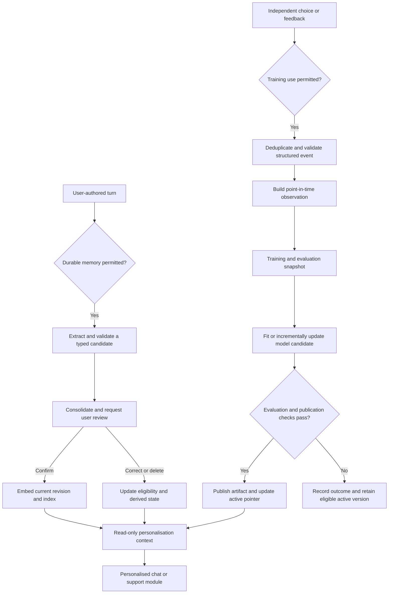

# AutiConnect system architecture

## Architecture decisions

Use one Next.js application, one modular FastAPI backend and one Supabase project. Keep request handling, memory, prediction and LLM generation independently testable in the backend. Use a separate command from the same Python package for training and maintenance. A small PostgreSQL job ledger will support work that needs retry. The synthetic demonstration can run with one worker and private artifact storage.

## M1 implementation

Next.js renders the dashboard and handles email/password Auth through server actions and a confirmation route. An SSR Proxy refreshes the session into HTTP-only cookies. The protected layout and profile action check verified claims again. Next.js makes uncached server-to-server requests to FastAPI, so the browser does not need the API origin or an access token in JavaScript.

FastAPI serves versioned health and owner-profile endpoints. The Supabase adapter verifies a presented JWT with hosted Auth, checks its issuer, audience, expiry, role and subject, and forwards that user token and the project's publishable key to PostgREST. Profile reads and writes derive the owner from verified identity and PostgreSQL rechecks ownership under RLS. The service logs request IDs, route templates, duration and status. Its health endpoint checks process liveness. A profile save and read verifies the database path.

M1 has no AI runtime or training worker. The remaining sections describe interfaces and workflows for later milestones.

| Component | Responsibility and interface |
| --- | --- |
| Frontend | Render onboarding, settings, chat, memory review and the Learning Lab. Use Supabase Auth for sessions. Send the signed-in user's access token to the API. |
| API and authorisation | Verify the token signature and configured issuer, audience, and expiry. Derive the actor from the verified subject. Validate request structure, route purpose, permissions and resource ownership. User-facing database access preserves the authenticated context so RLS applies. |
| PostgreSQL and pgvector | Own profile, preferences, goals, conversations, reviewed memories, consent, events, registry and active model pointers. Filter by account and eligibility before ranking memory vectors. Use private storage for artifacts and load them through an authorised registry record. |
| Memory and embedding | Accept reviewable proposed facts and actions, record sources and revisions, encode eligible text with a pinned encoder and return bounded ranked evidence. The embedding provider is independent of the LLM provider. |
| Preference learning | Validate structured observations, generate point-in-time features, fit a synthetic starter and update account-specific candidates offline. The registry records the active pointer, parents, metrics, artifacts and eligibility. |
| Unified user model and orchestration | Assemble confirmed profile fields, scoped preferences, selected goals, relevant reviewed memories, permitted behaviour summaries and eligible predictions into a typed request-scoped view. Preserve the origin and validity of each field and apply the precedence rules below. |
| Conversation and generation | Maintain bounded working context, build a prompt from the current turn and selected evidence, call an interchangeable LLM provider, validate structured output and attach supported evidence references. |
| Learning Lab | Read owner-scoped memories, choices, explanations, model and correction history, and separately labelled synthetic cohort benchmarks. Show the reason for abstention and provide controls for review, correction and deletion. |

Use separate LLM operations for chat and schema-constrained extraction. Start by evaluating a local Sentence Transformers encoder and pin its revision, vector dimension and cosine metric. Use fake generation and embedding adapters for deterministic contract tests. Privileged database credentials stay on the server. Background operations use narrowly granted access, derive the owner from the stored job and recheck permissions and consent. [Supabase row-level security](https://supabase.com/docs/guides/database/postgres/row-level-security)

## Personalised request sequence

For an individual interaction, resolve a direct instruction first, then a confirmed setting for the matching scope, a confirmed general setting, an eligible model estimate, and finally the application default. User-authored source text remains data within the prompt. When an optional retrieval component fails, continue with permitted context and the default format. If generation is unavailable, display a retryable error. Recheck invalidation for in-flight results before reuse or response delivery.

## Learning and memory data flow

Make interaction intake independent of LLM-generated content. A background command processes validated jobs and evaluates model candidates before promotion. Snapshots record the data epoch and expected active pointer. Verify artifact integrity and recheck both values when publishing. An update can change fitted parameters without becoming eligible for serving.

## Knowledge reuse across modules

A module calls `resolve_context(actor, purpose, task_context)` with an authenticated actor, a purpose derived from its registered route and a task category. The result contains just the permitted preference, selected goals or memories, and usable prediction evidence. It remains request-scoped. Modules submit compatible choices through the same interaction contract and link them to the context and options shown. Core components own the shared schema and precedence logic.

For example, a confirmed general checklist preference recorded during chat can guide preparation in daily planning. A checklist preference confirmed only for planning applies to that scope. A planning module can contribute a deliberate format choice to the same account's learning stream when the choice matches the target contract and the user consents. Learning activities, communication assistance, education and employment guidance, and caregiver collaboration reuse the interface when their purpose and permissions allow it. Caregiver access requires a separate user-granted sharing design.

M5 introduces the minimum context assembly needed for RAG. M9 formalises the shared context contract. M12 verifies reuse with a small daily-planning slice. See the [memory lifecycle](MEMORY_DESIGN.md), [AI layer design](AI_ARCHITECTURE.md), and [roadmap](ROADMAP.md).

## Operational limits and open decisions

- Keep the first search exact, retrieval uncached, personalization read-only at inference time, and training off the request path. Benchmark before adding approximate indexes or more workers.
- Record request and job IDs, versions, duration and failure categories. Exclude raw prompts, memory text, access tokens and row-level feature payloads from operational logs.
- Verify the LLM provider, embedding checkpoint and dimension, data retention and latency budgets in their implementation milestones. Keep all initial runs synthetic.
