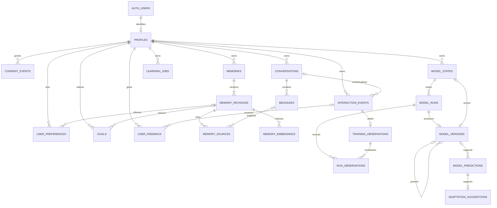

# AutiConnect database design

Use Supabase PostgreSQL for account data, provenance and model metadata, pgvector for memory embeddings, and private storage for model files. This logical design guides migrations from M1 onward. Public schema access and API permissions should be limited to the workflows that need them.

M1 implements [the foundation migration](../supabase/migrations/202611250001_foundation.sql). It enables pgvector and creates a minimal `profiles` table for display names. The primary key doubles as the owner index and references `auth.users` with account deletion cascading to the profile. Constraints and a database trigger protect name and timestamp fields. Authenticated requests can select, insert and update their own profile under RLS. Profile onboarding and the remaining entities below follow in later milestones.

## Entity relationships

The tables below specify keys and lifecycle fields omitted from the diagram. Use UUIDs for resource identifiers and UTC `timestamptz` for timestamps. Each account-owned resource carries a non-null `user_id`. An event's occurrence, availability for prediction and persistence can have different timestamps.

| Entity | Key fields and lifecycle |
| --- | --- |
| `profiles` | Primary key `user_id` references `auth.users`. Holds allowlisted user-entered fields and onboarding timestamps. |
| `consent_events` | Owner, purpose, decision, notice version, effective time and operation key. Latest committed decision per purpose is authoritative. Absence means disabled. Record separate decisions for durable memory and behavioural training. |
| `user_preferences`, `goals` | Owner, typed value or goal, scope, user-action time, status and optional source revision. One active preference per owner, setting and normalised scope. Explicit settings and goal progress are authoritative in these tables. |
| `conversations`, `messages` | Owned conversation, expiry, message author role, content and timestamps. Session history is bounded. A retained source used in memory review has a defined retention and deletion path. |
| `memories`, `memory_revisions` | Logical claim, kind and scope plus optional pointer to a current confirmed revision. Revisions carry typed value, review state, effective dates, extractor version and correction lineage. |
| `memory_sources`, `memory_embeddings` | Source edges link a revision to an owned message or a direct user action with timestamps and source type. An embedding references a confirmed revision and records encoder revision, distance configuration and a `vector(d)` value. |
| `interaction_events` | Stable event key, owner, module, optional conversation, target, pre-choice task category and options, suggestion-exposure flag, choice and event/availability times. Store consent reference and the versioned allowlisted payload. |
| `user_feedback` | Owner, optional related event, target resource or action, feedback type, optional structured value and timestamps. Choice feedback links to its existing event when eligible. Generic ratings and memory corrections remain independently interpretable. |
| `training_observations` | Owner, event, target, feature version and vector, label, prediction time and label availability. Unique logical observation per event and target. A corrected feature artifact or schema version does not generate a second label. |
| `model_states` | Unique owner and target, current version pointer and data epoch used for atomic promotion. Advance the epoch when observation eligibility changes through corrections, deletion or consent transitions. |
| `model_runs`, `run_observations` | Owner, target, purpose, data epoch, watermark, expected active pointer, status, metric and split manifest references. Membership records fit or gate observation IDs and supports audit and deduplication. Synthetic cohort manifests travel with experiment artifacts. |
| `model_versions` | Owning account, originating run, optional account parent, immutable synthetic starter reference, artifact path and checksum, feature and dependency versions, evaluation eligibility and timestamps. Synthetic starters are registered by immutable reference, with no shared account data. |
| `model_predictions` | Inferred preferences live here. Store owner, target, scope, version for scored predictions, estimated class scores or abstention reason, compact eligible evidence references, created time and expiry. Retain only what the Learning Lab needs to explain and invalidate a prediction. |
| `adaptation_suggestions` | Owner, prediction, scope and proposed/accepted/dismissed/expired state. Save a distinct row only for a user-visible suggestion requiring a lifecycle. Acceptance changes a confirmed preference only through an explicit save action. |
| `learning_jobs` | Owner, operation key, purpose, narrow resource references, retry status and timing. Holds no transcript or artifact payload. |

Feedback references for memory review and suggestions point to the matching owned resource type. Implement typed references with same-owner foreign keys for the workflows actually added. Review and suggestions may use an existing action row rather than storing a duplicate copy of its value.

## Constraints and permissions

- Use composite foreign keys such as `(user_id, conversation_id)` to `conversations(user_id, id)`. Also scope current-revision links to their memory and model pointers and parents to their target. Verify that every source, embedding and run membership belongs to the same owner. Define explicit deletion actions for references that may be removed independently.
- Enforce allowed states, timestamps and nonempty normalised scopes. Guarantee one eligible embedding per revision and encoder and one current confirmed value per single-valued claim and scope. Episodes can have repeated facts at different occurrence times. Use unique operation keys for input retries, observation creation, extraction and job publication.
- Use Supabase Auth for application identity and PostgreSQL RLS plus grants for data authorisation. Authorised owner policies compare `user_id` to `auth.uid()` for reads and mutations, using both row-selection and write checks. Keep internal metadata and background writes private and grant the worker only required operations. Use invoker-security result views so underlying RLS applies, and derive scope inside user-facing functions. Credentials that bypass RLS stay server-side. Test with two authenticated synthetic users and an unauthenticated session. [Supabase row-level security](https://supabase.com/docs/guides/database/postgres/row-level-security)
- Treat user permissions as the verified actor's ownership, route purpose and independent consent decisions. The prototype needs no separate roles or sharing table. Add a separate grant model if a future caregiver workflow authorises cross-account access.

## Indexes and vector querying

- B-tree indexes start with the owner. Support conversation history by `(user_id, conversation_id, created_at)`, consent by purpose and effective time, memory by state/scope, observations by owner, target and `available_at`, and model history by target and creation time. Add indexes for foreign keys and uniqueness used by lookups, deduplication and cascades.
- Use exact cosine-distance ranking over eligible rows for the synthetic dataset. Require verified owner, allowed scope, current confirmed revision, timestamp validity and the same encoder revision in the same query. Apply a calibrated threshold and down-rank or discard irrelevant and redundant candidates at orchestration. Measure recall@k and p95 latency before selecting an approximate index. On encoder change, reindex eligible revisions and switch serving to the new vector dimension and revision together. [pgvector search and filtering](https://github.com/pgvector/pgvector)
- Store artifacts at immutable private paths with checksums and approved formats. Resolve access through eligible model records and load only files written by trusted jobs. The registry transaction changes the active pointer after artifact verification.

## Retention, correction and deletion

Keep user-visible policy for transcripts, working context, memories, feedback, predictions and backups. During the demo, apply configured retention to synthetic data and verify expiration logic. Set retention periods before approved human data is collected. Use minimal replay markers only for the period needed to suppress duplicate work. After a restore, reapply pending deletions before opening access.

A memory correction points to a new revision and immediately excludes obsolete evidence. Deletion hides the content, evidence and embeddings in the same logical operation and queues physical purging where needed. Propagate a source deletion to revisions and output traces whose eligibility relied on it. Exclude affected assistant turns from future working context. Offer separate controls for independently saved settings and goals. Disabling durable memory pauses extraction and retrieval while allowing review and deletion. Pending jobs record the authorising consent decision and must revalidate it at write time, including after a later opt-in.

Withdrawal of behavioural training consent stops collection, updates and personal model serving. Training-data deletion removes the input from eligibility and bumps the epoch before any worker can publish. For the single-target prototype, conservatively invalidate earlier personal versions and predictions for the account and target because earlier observations may feed later history features. Purge affected artifacts, evidence links and row-level run or feature data. Recompute surviving features and rebuild from the synthetic starter. Keep only deletion-safe run metadata. Check artifact checksum, target, feature version, data epoch and consent before promotion or rollback. See the [learning lifecycle](ML_TRAINING_PLAN.md).
